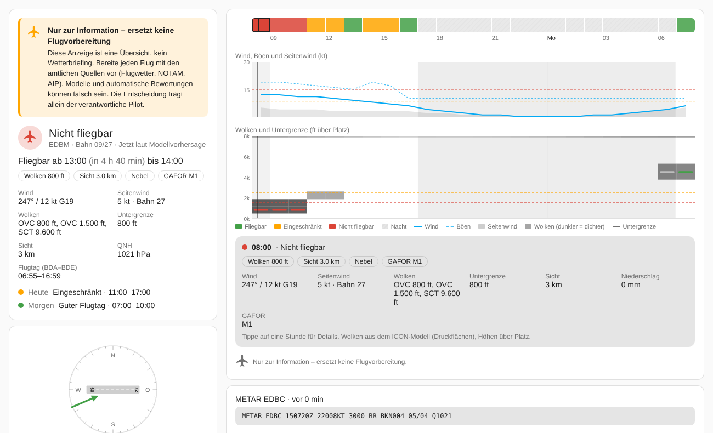
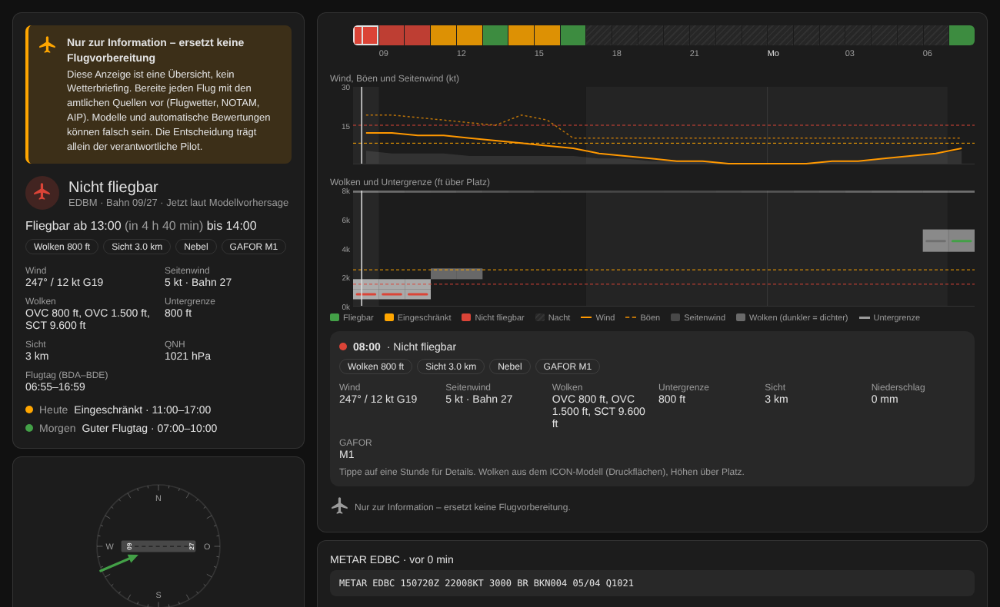

# VFR Flight Weather for Home Assistant


> [!CAUTION]
> **For information only. This integration does not replace your pre-flight preparation.**
> It is a quick overview, not a weather briefing. Before every flight, prepare yourself as required by SERA and your national rules, using official sources (aviation weather services, NOTAMs, AIP). Forecast models and automated evaluations can be wrong. The pilot in command remains solely responsible for the decision to fly.

A flying-weather traffic light for VFR pilots. For every airfield you add, the integration rates each hour for wind, gusts, crosswind, cloud ceiling, visibility, precipitation, thunderstorms and the German GAFOR. It tells you whether it is flyable **now** and when the **next flight window** starts, and shows a 24-hour timeline with wind and cloud layers, METAR, TAF and the DWD aviation weather overview.



<details><summary>Dark theme</summary>



</details>

*Screenshots with sample data. The dashboard follows your Home Assistant language (German or English notice) and theme.*

## Features

- Set up in the UI: enter an ICAO code, then confirm airfield data, nearest METAR/TAF station and GAFOR region
- Several airfields at once, each as its own device
- Your own limits (amber/red) for crosswind, wind, gusts, ceiling, visibility and precipitation
- The current hour is rated from the latest METAR, later hours from the model forecast
- Cloud layers (FEW/SCT/BKN/OVC) and ceiling from the DWD ICON model
- Daytime = civil twilight (morning to evening civil twilight)
- Dashboard strategy “VFR-Flugwetter” in *Add dashboard → Community dashboards*, adjustable later via the gear icon
- Card `custom:vfr-flight-weather-card` with the views `jetzt` (now), `zeitstrahl` (timeline), `wind`, `meldungen` (reports), `dwd` or `komplett` (all)
- Colours and fonts follow your active Home Assistant theme

## Sensors

| Sensor | State | Useful attributes |
|---|---|---|
| Flying weather now | `fliegbar` (flyable), `eingeschraenkt` (limited), `nicht_fliegbar` (not flyable), `nacht` (night) | `gruende` (reasons), `fliegbar_bis`, `naechstes_fenster_start`, `naechstes_fenster_ende`, `stunden` |
| Next flight window | timestamp of the next green window | `ende` |
| Cloud ceiling | ft above aerodrome, empty if none | `bewoelkung` |
| Flying day today / tomorrow | `gut`, `eingeschraenkt`, `schlecht`, `vorbei` (day over) | `fenster`, `gruende` |
| METAR, TAF | raw report / station | wind, visibility, clouds, QNH |
| GAFOR | code of the current window | `fenster`, `uebersicht` (DWD text) |
| Crosswind now | kt from METAR | `gegenwind_kt`, `aktive_bahn` |

Example automation: a notification in the evening when tomorrow looks good.

```yaml
triggers:
  - trigger: time
    at: "19:00:00"
conditions:
  - condition: state
    entity_id: sensor.edbm_magdeburg_city_flugtag_morgen
    state: gut
actions:
  - action: notify.mobile_app_my_phone
    data:
      title: "Flying weather tomorrow ✈️"
      message: >
        {{ state_attr('sensor.edbm_magdeburg_city_flugtag_morgen', 'fenster') }}
        – for information only, do your own pre-flight preparation.
```

## Installation

1. **Settings → Marketplace → Custom repositories**: add `https://github.com/chrisribal/ha-vfr-flight-weather` as an integration and install “VFR Flight Weather”. Restart Home Assistant.
2. **Settings → Devices & services → Add integration → VFR Flight Weather**.
3. Create the dashboard: **Settings → Dashboards → Add dashboard → VFR-Flugwetter**.

## How it rates

| Criterion | Amber from (default) | Red from (default) |
|---|---|---|
| Crosswind | 8 kt | 15 kt |
| Wind | 15 kt | 20 kt |
| Gusts | 20 kt or 10 kt above mean wind | 25 kt |
| Ceiling (lowest BKN/OVC layer) | below 2500 ft AGL | below 1500 ft AGL |
| Visibility | below 8 km | below 5 km |
| Precipitation | 0.2 mm/h | 1.0 mm/h |
| GAFOR | D | M or X |
| Weather | light snow, rain (METAR) | thunderstorm, fog, freezing precipitation, snow |

“Today” only rates the remaining daytime hours. A day is **good** with at least three consecutive green hours and **limited** with at least two consecutive hours without red.

## Data sources

- Model forecast and cloud layers: [Open-Meteo](https://open-meteo.com/) (DWD ICON)
- METAR, TAF, airfield data: [Aviation Weather Center](https://aviationweather.gov/data/api/)
- GAFOR and aviation weather overview (Germany): [Deutscher Wetterdienst](https://www.dwd.de/DE/fachnutzer/luftfahrt/teaser/luftsportberichte/luftsportberichte_node.html), shown unchanged

GAFOR and the DWD overview are only available for Germany; everything else works worldwide. Please respect the terms of use of the data sources.

## Development

Requirements: Python 3.13 and a Home Assistant with the “Advanced SSH & Web Terminal” app (SSH access with a key).

```bash
python -m venv .venv && . .venv/bin/activate
pip install pytest-homeassistant-custom-component home-assistant-frontend
pytest -q                      # tests without Home Assistant

cp .env.example .env           # set HA_SSH=root@homeassistant.local
./deploy.sh                    # copy to your Home Assistant, check the configuration, restart
./deploy.sh --no-restart       # copy only (e.g. frontend changes, then reload the browser)
```

In VS Code the same steps are available as tasks (*Terminal → Run Task*).

## Disclaimer

This project is provided “as is”, without any warranty. It is for information only and must never be used as the sole basis for a flight decision. Always carry out a complete pre-flight preparation with official sources.

## License

MIT
